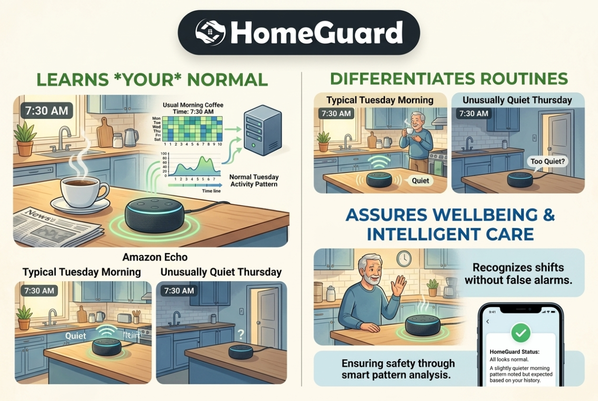

## What is HOMEGUARD?

HomeGuard is an open-source wellbeing agent for people living alone. It brings together signals from a simulated Alexa+ experience, Fire TV, Ring, and an explicitly mocked Bee wearable through a shared, real MCP server. Instead of sending an alert whenever a sensor goes quiet, it learns a person’s routine and looks for meaningful changes. Then checks in with the resident before involving a caregiver.



HomeGuard learns the resident's personal everyday baseline, detects subtle behavioral anomalies (e.g. morning inactivity or abrupt cessation of TV interaction), explains deviations in plain language and chooses whether to gather more context, ask the resident a question, or notify a caregiver. Check-ins can be answered to Alexa by voice or through Fire TV’s remote-friendly screen. A successful response resolves the incident; an unanswered check-in can lead to caregiver notification. Integrations are clearly labeled as real, simulated, or mocked.

This matters because a quiet moment can be normal, or concerning, depending on the person and the context. HomeGuard aims to reduce false alarms and caregiver anxiety while respecting the resident’s privacy and independence. It checks the least intrusive channels first, does not make medical claims, accesses more information only when less intrusive information isn't enough and escalates only when the situation remains unresolved.

---

## Quickstart — Running the Complete Experience

### 1. Prerequisites & Installation

```bash
# Clone and install dependencies
npm install

# Build the MCP check-in UI bundle (bundled single-file HTML for Fire TV / MCP App hosts)
npm run build:ui --workspace=@homesense/homeguard-mcp
```

### 2. Start the MCP Server

```bash
npx tsx services/homeguard-mcp/src/index.ts
```
> The real MCP Server starts at **`http://localhost:3000/mcp`** (using official `@modelcontextprotocol/sdk` with Streamable HTTP transport).

---

## 🌟 Master Unified 3-Pane Dashboard (Recommended)

The easiest and most comprehensive way to experience HOMEGUARD is through the **Unified Dashboard**, showing the resident's home, the agent's brain, and the caregiver's phone in a synchronized multi-pane view:

In a new terminal:
```bash
npm run dashboard
```
Open your browser to:
👉 **[http://localhost:5173](http://localhost:5173)**

### What you see in the Dashboard:
1. **Pane 1: Maria's Home**
   - **Fire TV Screen**: 10-foot ambient TV screen running the real MCP check-in app (`ui://homeguard/checkin`).
   - **Echo Speaker (Alexa+)**: Glowing LED light ring (Idle Cyan, Prompt Orange, Listening Pulse, Resolved Green).
   - **Ring Entrance Camera**: Front door status ("Is she home or out?"), gated snapshot preview with audit log.
2. **Pane 2: HomeGuard Brain**
   - **Escalation Ladder (L0 → L3)**: Visual status tracking across Normal (L0), Low/Medium Routine Deviation (L1), High Anomaly (L2), and Caregiver Escalation (L3).
   - **Explainable Deviation Gauge**: Live confidence score (0.0 to 1.0) with plain-English reasons from `computeDeviation()`.
   - **Real MCP Activity Trace**: Live log of `Streamable HTTP /mcp` tool calls (`get_behavior_deviation`, `request_checkin`, `get_ring_event`, `notify_caregiver`).
3. **Pane 3: Eleni's Phone (Caregiver)**
   - **Today View**: Quiet day status ("Everything aligns with 30-day baseline").
   - **Real-Time Push Alert**: Triggered via Server-Sent Events (`GET /caregiver/stream`) when unresolved check-ins occur.
   - **"Why I'm Checking" Detail**: Explainable reasons, Ring camera audit log, and one-tap incident acknowledgment.

---

## Individual Component Simulators

You can also run and inspect each device experience standalone:

### Fire TV 10-foot App Shell & Remote Simulator
```bash
npm run firetv
```
👉 **[http://localhost:5174](http://localhost:5174)**
- 10-foot UI designed for television viewing distance (1080p canvas, manifest.json).
- Interactive **Fire TV Alexa Voice Remote simulator**: genuine D-pad navigation (arrow keys or mouse click), `SELECT` / `OK`, and Microphone button for voice replies.
- Embeds dedicated MCP Apps host with `AppBridge` and `PostMessageTransport`.

### Alexa+ Echo Simulator
```bash
npm run alexa
```
👉 **[http://localhost:5175](http://localhost:5175)**
- Realistic Amazon Echo cylindrical speaker with dynamic 360° LED ring animations.
- Audio waveform visualizer and browser SpeechSynthesis (Alexa voice check-in).
- Web Speech recognition & quick-action voice pills ("I'M OK", "I NEED HELP").
- Directly calls `/mcp` tool `respond_checkin`.

---

## Architecture & Integration Status

```
packages/event-model     Zod schemas: NormalizedEvent, Resident, Baseline, Deviation, CheckIn, AgentAction
services/policy          decideAgentAction() — pure, configurable thresholds (0.6 / 0.8)
services/behavior-engine computeDeviation() — deterministic, explainable (reasons[] array)
adapters/bee             BeeAdapter interface + MockBeeAdapter (mode: "mock")
adapters/alexa           AlexaVoiceAdapter interface + SimulatedAlexaAdapter (browser speech + normalized events)
adapters/ring            RingAdapter interface + MockRingAdapter (entrance camera, privacy gate, mock snapshot)
services/homeguard-mcp   Official MCP SDK 1.30.0, Streamable HTTP /mcp, 10 tools + MCP App resource (ui://homeguard/checkin)
apps/firetv              10-foot Fire TV web app shell + D-pad remote simulator + MCP App host
apps/alexa-sim           Echo simulator + glowing LED light ring + voice recognition + real MCP connection
apps/dashboard           Unified 3-pane master dashboard (Maria's Home, Agent Brain, Caregiver Phone)
```

| Component | Integration Mode | Description |
| :--- | :--- | :--- |
| **Alexa+** | **SIMULATOR** | Official web simulator with agentic tools, browser voice TTS/STT, and real `/mcp` tools. |
| **MCP** | **REAL** | Official `@modelcontextprotocol/sdk` v1.30.0, Streamable HTTP transport at `/mcp`. |
| **Fire TV** | **SIMULATOR** | 10-foot TV shell with manifest.json, D-pad remote simulator, and embedded MCP Apps host. |
| **Ring** | **MOCK / PRIVACY GATE** | Entrance camera ("is she home or out?"). Snapshot strictly guarded by server-enforced 4-condition privacy gate. |
| **Caregiver Mobile**| **REAL SSE STREAM** | Live push alerts via `GET /caregiver/stream`, briefing API, and incident acknowledgment. |
| **Bee Wearable** | **MOCK** | Explicit mock (`mode: "mock"`). Hardware access constraint (US/iOS-only). |
