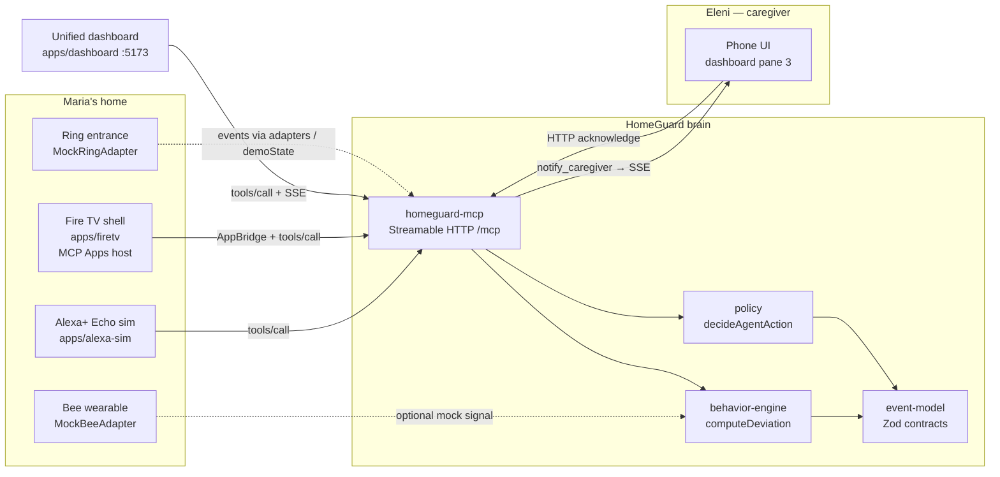
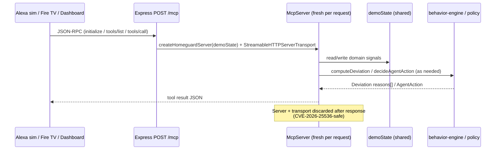

# Architecture — as built

This diagram matches what is **actually running** in the repo today
(Alexa+ primary track, real MCP, supporting Fire TV + Ring).

## System context



## Request path (MCP)



## Escalation ladder (runtime)

| Level | Name | What runs | Who is affected |
| :---: | :--- | :--- | :--- |
| L0 | Observe | `get_behavior_status`, baseline, events, deviation, schedule, Ring metadata | Nobody |
| L1 | Verify | `request_checkin` → Alexa voice then Fire TV overlay; `respond_checkin` | Maria |
| L2 | Gather context | Gated `get_ring_event(include_media=true)` | Maria’s privacy (audited) |
| L3 | Contact caregiver | `notify_caregiver` → SSE → phone UI | Eleni |

Human acknowledge is **not** an MCP tool.

## Package map

```
packages/event-model       Shared Zod types
services/behavior-engine   Deterministic deviation scoring
services/policy            Pure decideAgentAction + HomeGuardPolicy
services/homeguard-mcp     MCP server, MCP App UI, caregiver HTTP/SSE
adapters/alexa             SimulatedAlexaAdapter
adapters/ring              MockRingAdapter (entrance + snapshot placeholder)
adapters/bee               MockBeeAdapter (mode: "mock")
apps/dashboard             3-pane demo (Maria / Brain / Eleni)
apps/firetv                10-foot shell + MCP Apps host
apps/alexa-sim             Echo / Alexa+ simulator + MCP client
```

## Integration modes (enforced in UI)

| Component | Mode |
| :--- | :--- |
| Alexa+ | SIMULATED (web agentic client) |
| MCP | **REAL** (SDK Streamable HTTP) |
| Fire TV | SIMULATOR |
| Ring | MOCK + server Ring Gate |
| Bee | MOCK |
| Caregiver phone | SIMULATED view of real notify/SSE |
| Baseline history | SEEDED SYNTHETIC (computation real) |

## Deliberately not in this build

- Production Alexa+ OAuth 2.1 / PKCE / PRM account linking
- AWS hosting (Lambda / API Gateway / Bedrock)
- Real Bee or Ring cloud accounts
- SQLite persistence (in-memory `demoState` only)
- Level-4 re-notify / emergency services (roadmap, never claimed)

## Related

- Privacy rules: `docs/privacy.md`
- Submission / friction / feedback: `SUBMISSION.md`
